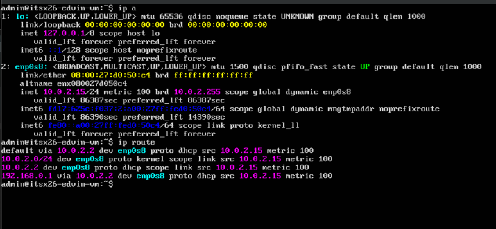
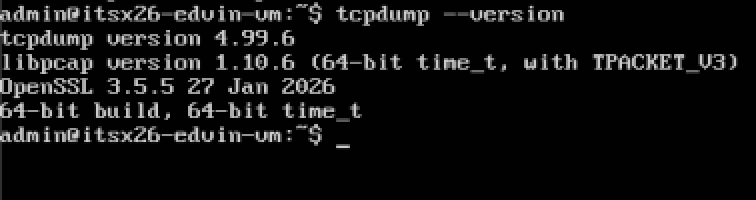
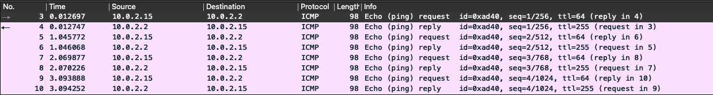
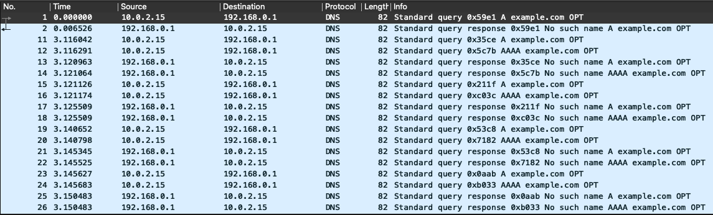
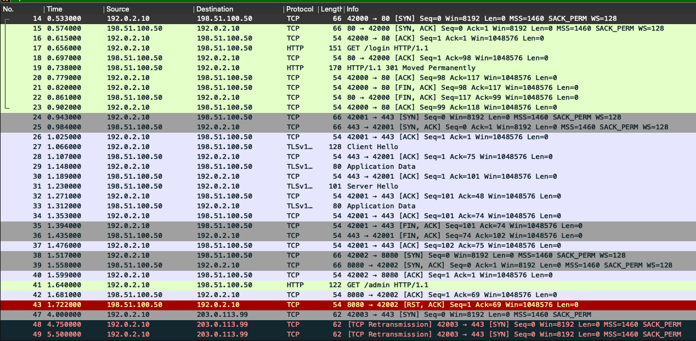
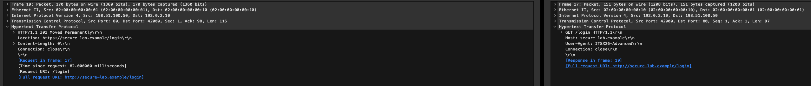
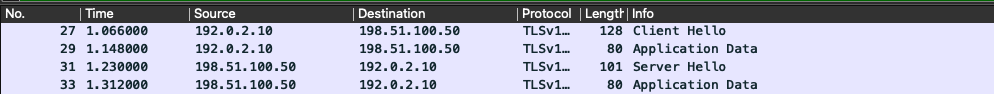

# Network Traffic Investigation – Vecka 38

## Del A – Miljö och metod

Jag genomförde nätverksundersökningen i en lokal Ubuntu Linux-VM som körs i VirtualBox på min Mac.

VM:n hade följande nätverkskonfiguration:

- Interface: `enp0s8`
- IPv4-adress: `10.0.2.15/24`
- Default gateway: `10.0.2.2`
- Loopback: `127.0.0.1`

Min default route gick via `10.0.2.2` genom `enp0s8`.

### Nätverkskonfiguration

Jag använde kommandona `ip a` och `ip route` för att kontrollera VM:ns nätverkskonfiguration. Bilden nedan visar bland annat interfacet `enp0s8`, IPv4-adressen `10.0.2.15/24` och default gateway `10.0.2.2`.



### Verktyg

Jag använde `tcpdump` i Linux för att samla in nätverkstrafiken och Wireshark på min Mac för att analysera pcap-filen.

Jag kontrollerade även att `tcpdump` var installerat innan insamlingen.



### Insamling

Jag gjorde en egen paketfångst med `tcpdump`. Jag fångade trafiken på interfacet `enp0s8`.

Fångsten begränsades till 100 paket och SSH-trafik på TCP-port 22 filtrerades bort för att minska mängden irrelevant trafik.

Kommandot för fångsten var:

```bash
sudo tcpdump -i enp0s8 -s 0 -c 100 'not tcp port 22' -w week38_traffic.pcap
```

Jag genererade DNS- och ICMP-trafik från Linuxmiljön.

DNS-frågan för `example.com` gav dock svaret NXDOMAIN. Därför kunde HTTP- och HTTPS-anslutningarna mot det målet inte genomföras.

Jag valde att inte byta till ett godtyckligt externt mål eftersom uppgiften begränsar vilka externa mål som får användas.

För TCP, HTTP och TLS/HTTPS använde jag därför lärarens tillhandahållna pcap som kompletterande reservmaterial.

Min egen pcap används för DNS och ICMP. Lärarens pcap används för TCP, HTTP och TLS/HTTPS.

Råa pcap-filer publiceras inte på GitHub. Jag har granskat skärmbilderna innan publicering för att kontrollera att de inte innehåller lösenord, tokens, cookies eller annan känslig information. Endast relevanta skärmbilder används som evidens.

Till skillnad från lärarens OCI-demonstration använder jag en lokal Linux-VM i VirtualBox. Nätverksprinciperna är dock desamma, exempelvis IP-adressering, routing, DNS, TCP och applikationsprotokoll.


# Del B – Paketets väg

Jag använder ICMP-trafiken mellan min Linux-VM och dess gateway som exempel från min egen pcap.

Min Linux-VM har adressen:

`10.0.2.15`

och kommunicerar genom interfacet:

`enp0s8`

Default gateway är:

`10.0.2.2`

I paket 3 skickar VM:n ett ICMP Echo Request:

`10.0.2.15 → 10.0.2.2`

I paket 4 kommer motsvarande Echo Reply tillbaka:

`10.0.2.2 → 10.0.2.15`

Samma mönster upprepas ytterligare tre gånger i paket 5–10.



### Direkt observerat

I pcap-filen kan jag direkt observera:

- Källadressen `10.0.2.15`
- Destinationsadressen `10.0.2.2`
- Protokollet ICMP
- Echo Request
- Echo Reply
- Paketens ordning

### Nätverksteknisk förklaring

Adressen `10.0.2.15` är en privat IPv4-adress och används av VM:n i det virtuella nätverket.

När VM:n kommunicerar med destinationer utanför sitt lokala nät används default gateway `10.0.2.2`. VirtualBox kan därefter använda NAT för trafik mellan det privata virtuella nätverket och andra nät.

En brandvägg kan också fatta beslut om trafik ska tillåtas eller blockeras.

Jag kan däremot inte enbart från ICMP-paketen fastställa exakt hur all NAT- eller brandväggshantering sker. Detta är därför en nätverksteknisk förklaring och inte något som direkt kan observeras i dessa paket.

ICMP använder inte TCP- eller UDP-portar, så någon transportport finns inte i detta flöde. Destinationen 10.0.2.2 är dessutom VM:ns gateway och inte en publik destination. Därför kan jag inte observera en publik destinationsadress eller hela NAT/PAT-förloppet i just detta ICMP-flöde. NAT/PAT är relevant när VM:n kommunicerar vidare från sitt privata nät mot externa nät, men det ska skiljas från vad som direkt kan observeras i den här fångsten.


# Del C – Protokollinventering

| Protokoll | Evidens | Observation |
|---|---|---|
| DNS | Egen pcap, paket 1–2 | VM:n frågar efter A-post för `example.com` och får NXDOMAIN. |
| ICMP | Egen pcap, paket 3–10 | Fyra Echo Requests skickas till gatewayen och samtliga får Echo Reply. |
| TCP | Lärarens pcap, paket 14–16 | Komplett TCP three-way handshake till TCP-port 80. |
| HTTP | Lärarens pcap, paket 17 och 19 | `GET /login` följs av `301 Moved Permanently`. |
| TLS/HTTPS | Lärarens pcap, paket 27–33 | Client Hello, Server Hello och Application Data kan observeras. |


## DNS

I min egen pcap skickar Linux-VM:n `10.0.2.15` i paket 1 en DNS-query till `192.168.0.1`.

Frågan gäller A-posten för:

`example.com`

I paket 2 svarar DNS-servern med:

`No such name`

Det innebär att DNS-frågan fick ett svar, men namnuppslaget gav ingen IPv4-adress.

Det visar att VM:n kunde kommunicera med DNS-servern, men själva namnuppslaget av `example.com` misslyckades.




## ICMP

I paket 3 skickar min Linux-VM `10.0.2.15` ett ICMP Echo Request till gatewayen `10.0.2.2`.

I paket 4 skickar gatewayen ett Echo Reply tillbaka.

Detta upprepas i paket 5–10 och samtliga fyra Echo Requests får svar.

Det visar att VM:n hade ICMP-nåbarhet till gatewayen vid tidpunkten för fångsten.

Det bevisar däremot inte att alla andra destinationer eller protokoll fungerar. ICMP-testet visar endast nåbarheten mellan dessa två endpoints med ICMP.


## TCP

I lärarens pcap visar paket 14–16 en komplett TCP three-way handshake.

Händelseordningen är:

1. Paket 14: `192.0.2.10:42000 → 198.51.100.50:80` – SYN
2. Paket 15: `198.51.100.50:80 → 192.0.2.10:42000` – SYN/ACK
3. Paket 16: `192.0.2.10:42000 → 198.51.100.50:80` – ACK

Det visar att TCP-anslutningen etablerades innan HTTP-data började skickas.




## HTTP

I paket 17 skickar klienten en HTTP-request:

`GET /login HTTP/1.1`

I paketet går det även att läsa:

`Host: secure-lab.example`

och:

`User-Agent: ITSX26-Advanced`

Den fullständiga URI:n visas som:

`http://secure-lab.example/login`

Servern svarar i paket 19:

`HTTP/1.1 301 Moved Permanently`

och anger:

`Location: https://secure-lab.example/login`

Det betyder att klienten hänvisas vidare från HTTP till HTTPS.

Eftersom HTTP-trafiken är okrypterad kan request, URI och headers läsas direkt i Wireshark.




## TLS/HTTPS

I lärarens pcap kan TLS-trafik observeras mellan `192.0.2.10` och `198.51.100.50`.

Exempel:

- Paket 27 – Client Hello
- Paket 29 – Application Data
- Paket 31 – Server Hello
- Paket 33 – Application Data

Till skillnad från HTTP kan jag inte läsa innehållet i Application Data direkt.

Jag kan däremot fortfarande se metadata såsom käll- och destinationsadress, trafikens riktning, paketstorlek och att TLS används.




# Del D – Fördjupad analys av två flöden

## Flöde 1 – HTTP över TCP

Det första flödet är kommunikationen mellan:

- Klient: `192.0.2.10:42000`
- Server: `198.51.100.50:80`
- Protokoll: TCP och HTTP

### Händelseordning

Paket 14 skickar SYN från klienten till servern.

Paket 15 innehåller SYN/ACK från servern.

Paket 16 innehåller ACK från klienten.

TCP-anslutningen är därmed etablerad.

I paket 17 skickar klienten:

`GET /login HTTP/1.1`

Servern svarar i paket 19:

`HTTP/1.1 301 Moved Permanently`

Servern hänvisar samtidigt klienten till:

`https://secure-lab.example/login`

Därefter avslutas TCP-anslutningen med FIN/ACK i paket 21–23.

### Förväntat beteende

Det förväntade beteendet är först en TCP three-way handshake och därefter utbyte av HTTP-data.

### Faktisk observation

Det är också vad som observeras. TCP-anslutningen etableras och servern svarar på HTTP-requesten.

Jag observerar ingen tydlig timeout, reset eller retransmission i detta flöde.

301-svaret innebär att servern hänvisar klienten till en annan URL. I detta fall visar `Location`-headern att klienten ska använda HTTPS.

För att undersöka vad som händer efter omdirigeringen behöver även den efterföljande HTTPS/TLS-trafiken analyseras.


## Flöde 2 – ICMP mellan VM och gateway

Det andra flödet kommer från min egen pcap.

- Källa: `10.0.2.15`
- Destination: `10.0.2.2`
- Protokoll: ICMP

I paket 3 skickas ett Echo Request från VM:n till gatewayen.

Paket 4 innehåller motsvarande Echo Reply.

Detta upprepas:

- Paket 3 → 4
- Paket 5 → 6
- Paket 7 → 8
- Paket 9 → 10

### Förväntat beteende

Det förväntade beteendet vid en fungerande ping är att varje Echo Request följs av ett Echo Reply.

### Faktisk observation

Det faktiska resultatet stämmer med det förväntade eftersom samtliga fyra requests får svar.

Jag observerar ingen paketförlust i dessa fyra paketpar.

Det går däremot inte att dra slutsatsen att all nätverkskommunikation fungerar enbart från detta test. En brandvägg kan exempelvis behandla ICMP och TCP olika.

För en säkrare bild av nätverkets funktion behöver därför även DNS och transportprotokoll som TCP analyseras, vilket görs i övriga delar av rapporten.

En alternativ förklaring vid uteblivna ICMP-svar hade kunnat vara att ICMP blockerades av en brandvägg, vilket inte automatiskt hade inneburit att destinationen var helt otillgänglig. I min fångst får samtliga requests svar, så någon sådan avvikelse observeras inte här.


# Del E – Krypterat och okrypterat

| Aspekt | HTTP | TLS/HTTPS |
|---|---|---|
| Synlig metadata | IP-adresser, portar, HTTP-metod, URI och headers | IP-adresser, portar, paketstorlek, riktning och TLS-information |
| Läsbar applikationsdata | Ja | Application Data är krypterad |
| Felsökningsvärde | Request och response kan analyseras direkt | Anslutning, TLS-handshake och trafikmönster kan analyseras |
| Konfidentialitetsrisk | Innehållet kan exponeras | Innehållet skyddas bättre, men viss metadata är fortfarande synlig |

Skillnaden syns tydligt i pcap-filen.

I HTTP-paket 17 kan jag läsa:

`GET /login HTTP/1.1`

Jag kan även läsa hostname, User-Agent och den fullständiga URI:n.

I TLS-flödet kan jag däremot se exempelvis Client Hello, Server Hello och Application Data, men innehållet i Application Data går inte att läsa direkt.

HTTPS/TLS ger därför bättre konfidentialitet för applikationsinnehållet. Kryptering innebär dock inte att all metadata försvinner. Exempelvis IP-adresser, portar, paketstorlek och timing kan fortfarande vara synliga.


# Del F – Brandvägg och hardening

Jag använder HTTP-flödet på TCP-port 80 som exempel.

Klienten `192.0.2.10` lyckas etablera en TCP-anslutning till `198.51.100.50:80`.

En brandvägg skulle principiellt kunna ha en regel som avgör om TCP-trafik till port 80 ska tillåtas eller blockeras.

Det är viktigt att skilja på att en tjänst lyssnar på en port och att en brandvägg tillåter trafik till porten.

En lyssnande tjänst innebär att ett program väntar på anslutningar på en viss port. En brandvägg kan fortfarande blockera trafik innan den når tjänsten.

Vid hardening kan principen `default deny` användas. Det innebär att trafik som inte uttryckligen behövs blockeras som standard.

Man bör också använda principen om minsta nödvändiga öppning. Endast de portar och tjänster som miljön faktiskt behöver bör vara åtkomliga.

I den analyserade trafiken används TCP-port 80 för HTTP och port 443 för HTTPS. Servern på port 80 skickar dessutom klienten vidare till HTTPS.

Det går däremot inte att fastställa serverns fullständiga brandväggskonfiguration enbart från pcap-filen.

Kopplat till tidigare hardening är principen att endast nödvändiga tjänster ska vara aktiva och nåbara. HTTP på port 80 och HTTPS på port 443 är rimliga om systemet faktiskt ska erbjuda en webbtjänst. Om en tjänst inte behövs bör den stängas av eller göras otillgänglig genom brandväggsregler. I den analyserade trafiken går det att se vilka portar som används, men inte avgöra vilka andra tjänster som eventuellt är aktiva på servern.


# Del G – CIA och evidens

## Konfidentialitet

En pcap kan innehålla information som IP-adresser, värdnamn, URL:er, headers och annan metadata.

HTTP-exemplet visar att information som `/login`, hostname och User-Agent kan läsas direkt.

TLS/HTTPS skyddar applikationsinnehållet bättre genom kryptering, men viss metadata är fortfarande synlig.

Rå pcap bör därför behandlas som potentiellt känslig information och inte publiceras öppet.


## Integritet

För att analysen ska vara spårbar dokumenterar jag vilka pcap-filer som använts och hänvisar till konkreta paketnummer.

Git-historiken visar dessutom förändringar i rapporten och evidensmaterialet.

Det gör det lättare att kontrollera vilken evidens slutsatserna bygger på.


## Tillgänglighet

ICMP-fångsten visar att `10.0.2.15` kunde kommunicera med gatewayen `10.0.2.2`.

DNS-fångsten visar att VM:n kunde skicka en DNS-fråga och få ett svar tillbaka, även om svaret för `example.com` var NXDOMAIN.

Det visar skillnaden mellan att själva DNS-tjänsten är nåbar och att ett specifikt namn faktiskt kan lösas upp.

TCP-handshaken i lärarens pcap visar dessutom ett exempel där transportlagret fungerar och en anslutning etableras.


## Evidenskvalitet

Min egen fångst är begränsad till 100 paket och visar därför bara en begränsad del av nätverkstrafiken.

HTTP och HTTPS kunde inte analyseras från min egen fångst eftersom DNS-uppslaget för det valda målet misslyckades. Därför kompletterades analysen med lärarens pcap.

En pcap visar endast den trafik som faktiskt fångades på det valda interfacet under fångstperioden.

Kryptering begränsar också vilken applikationsinformation som går att analysera.

Därför är det viktigt att skilja på sådant som direkt observeras och sådant som endast är en möjlig teknisk förklaring.


# Del H – Slutsats och rekommendation

Undersökningen visar hur flera olika nätverksprotokoll används och vilken information som går att få fram genom paketanalys.

I min egen fångst observerades DNS- och ICMP-trafik. Linux-VM:n `10.0.2.15` kunde kommunicera med sin gateway `10.0.2.2` via ICMP och samtliga fyra Echo Requests fick svar.

DNS-frågan för `example.com` fick däremot NXDOMAIN. Därför kunde jag inte skapa HTTP- och HTTPS-trafiken mot detta mål i min egen fångst.

För att kunna analysera resterande obligatoriska protokoll användes därför lärarens pcap som kompletterande evidens.

I den kunde en komplett TCP three-way handshake identifieras. HTTP-flödet visar en GET-request till `/login` och ett `301 Moved Permanently`-svar som hänvisar klienten till HTTPS.

Jämförelsen mellan HTTP och TLS visar också säkerhetsbetydelsen av kryptering. HTTP-informationen är direkt läsbar medan TLS skyddar applikationsinnehållet.

De starkaste slutsatserna är de som direkt kan kopplas till paketfångsten, exempelvis ICMP request/reply, DNS-svaret, TCP-flaggorna och HTTP-requesten.

En osäkerhet är att min egen fångst inte innehåller hela HTTP- och HTTPS-flödet. Dessa delar analyserades därför från lärarens pcap och kan inte användas för att dra slutsatser om exakt hur HTTP/HTTPS fungerar i min egen VM-miljö. Den egna fångsten är dessutom begränsad till 100 paket och visar därför endast en begränsad del av trafiken.

En rimlig säkerhetsåtgärd är att använda HTTPS för trafik där information behöver skyddas och att begränsa nätverkstjänster och brandväggsregler till vad som faktiskt behövs.

Vid fortsatt felsökning av min egen miljö skulle jag samla en ny avgränsad pcap efter att ha verifierat ett godkänt demonstrationsmål för HTTP/HTTPS. Då skulle samma trafikflöde kunna analyseras helt från den egna Linuxmiljön.


# AI-användning

Jag använde ChatGPT som ett hjälpmedel under arbetet, främst för att få förklaringar av nätverksbegrepp och för att kontrollera att jag hade tolkat uppgiften och trafiken korrekt.

Jag använde AI för att få hjälp med att förstå bland annat tcpdump, Wireshark-filter, DNS, ICMP, TCP-handshake, HTTP och TLS samt för att kontrollera att rapporten täckte de delar som efterfrågades i uppgiften.

Förslagen från AI användes inte utan kontroll. Jag jämförde uppgifterna med mina egna resultat i Wireshark och kontrollerade paketnummer, IP-adresser, protokoll, TCP-flaggor och HTTP/TLS-information mot pcap-filerna.

Vissa förslag ändrades eller användes inte när de inte stämde med min miljö. Ett exempel var att min egen DNS-fråga för `example.com` gav NXDOMAIN. Jag använde därför det faktiska resultatet från min fångst och kompletterade de delar som saknades med lärarens pcap i stället för att anta att anslutningen hade fungerat.

De observationer och slutsatser som finns i rapporten har jag kontrollerat mot den nätverksevidens som analyserades i Wireshark.